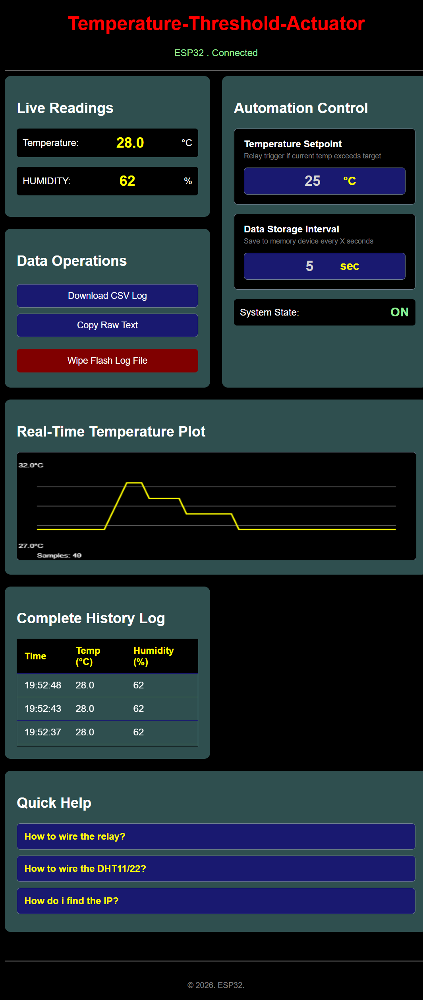

# Temperature Threshold Actuator

A MicroPython firmware stack for the ESP32-S3 (N16R8) that monitors temperature/humidity and drives a hardware relay. It features a lightweight web server with a real-time canvas dashboard, configuration adjustments, and local flash logging.

## Watch the Project Video
 **Check out the fully working demonstration here:** (https://github.com) *(LINK IS THIS https://www.youtube.com/watch?v=XXW-iPh-jk8)*

## Dashboard Preview


## Core Features
* **Decoupled Architecture:** Separated into `boot.py`, `logger.py`, and `main.py` for easier maintenance and low memory usage.
* **Local Flash Logging:** Appends data directly to `data.log` on the 16MB flash chip. It runs independently of the web interface connection status.
* **Adjustable Intervals:** Change sensor logging frequency directly from the UI. Settings persist across reboots.
* **Relay Actuation:** Triggers a physical relay automatically based on user-defined temperature thresholds.
* **OOM Prevention:** Streams web assets in 256-byte chunks to avoid Out-Of-Memory crashes and RAM fragmentation.
* **Data Export:** Export logs via a clipboard copy shortcut or download them directly as a `.csv` file.

---

## Hardware Requirements & Wiring Map
* **MCU:** ESP32-S3 N16R8 (MicroPython v1.20+)
* **Sensor:** DHT11 Temperature & Humidity Sensor
* **Actuator:** 5V / 3.3V Optocoupler Isolated Relay Module

### Pinout Configuration

| Component | ESP32-S3 Pin | Voltage / Power |
| :--- | :--- | :--- |
| **DHT11 Data** | GPIO 4 | 3.3V / GND |
| **Relay Signal (IN)** | GPIO 5 | 3.3V / GND |

---

## File Structure

* `.gitignore` - Excludes `secrets.py` from version control.
* `secrets_template.py` - Template file for network configuration.
* `secrets.py` - **(Ignored)** Holds your local Wi-Fi credentials.
* `boot.py` - Handles Wi-Fi connection and runs startup garbage collection.
* `logger.py` - Handles sensor reads and file system I/O.
* `main.py` - Web server, API endpoints, and request routing.
* `index.html` - Dashboard structure.
* `styles.css` - Dashboard styling.
* `dashboard.js` - UI updates, charting logic, and clipboard interactions.

---

## Quick Start

### 1. Configure Credentials
1. Rename `secrets_template.py` to `secrets.py`.
2. Add your Wi-Fi details:
   ```python
   # Station Mode (Connect to existing network)
   WIFI_SSID = "Your_Home_WiFi_Name"
   WIFI_PASS = "Your_WiFi_Password"
   
   # Access Point Mode (Standalone Hotspot)
   AP_SSID = "ESP32_Smart_Node"
   AP_PASS = "chuka1234"
   ```

### 2. Set Wi-Fi Mode
In `boot.py`, flip the boolean flag to match your environment:
* `USE_ACCESS_POINT_MODE = True` for a standalone hotspot.
* `USE_ACCESS_POINT_MODE = False` to connect to your local router.

### 3. Upload Files
Use an IDE like Thonny to upload all project files to the root directory of your ESP32-S3.

### 4. Run & Test
1. Connect via serial at **115200 Baud**.
2. Press the **EN / Reset** button on the board.
3. Copy the IP address printed to the terminal (defaults to `192.168.4.1` in AP mode).
4. Open the IP in any web browser to access the dashboard.

---

## API Reference

| Method | Endpoint | Content-Type | Description |
| :--- | :--- | :--- | :--- |
| **GET** | `/` | `text/html` | Serves the main dashboard page. |
| **GET** | `/api/sensors` | `application/json` | Returns current readings and logging interval. |
| **GET** | `/api/history` | `text/plain` | Streams raw log data for the canvas graph. |
| **GET** | `/api/download` | `text/csv` | Downloads log file as a CSV. |
| **POST** | `/api/relay` | `application/json` | Manually toggles GPIO 5. |
| **POST** | `/api/interval` | `application/json` | Updates the logging frequency setting. |
| **POST** | `/api/clear` | `application/json` | Deletes `data.log` from flash storage. |

---

## License
MIT License. Feel free to fork and modify.
